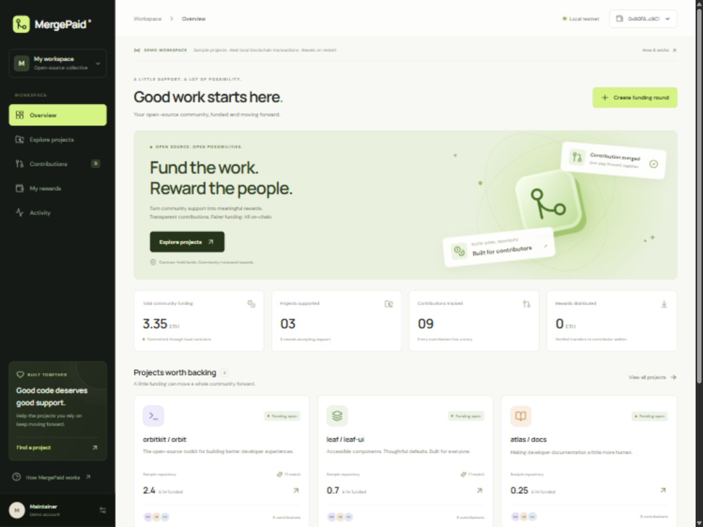
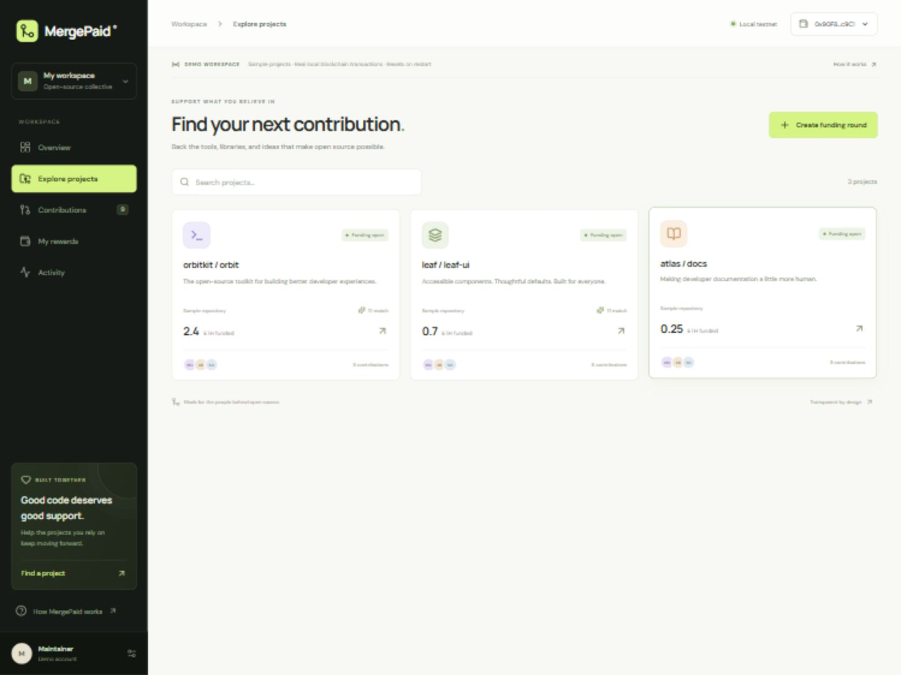
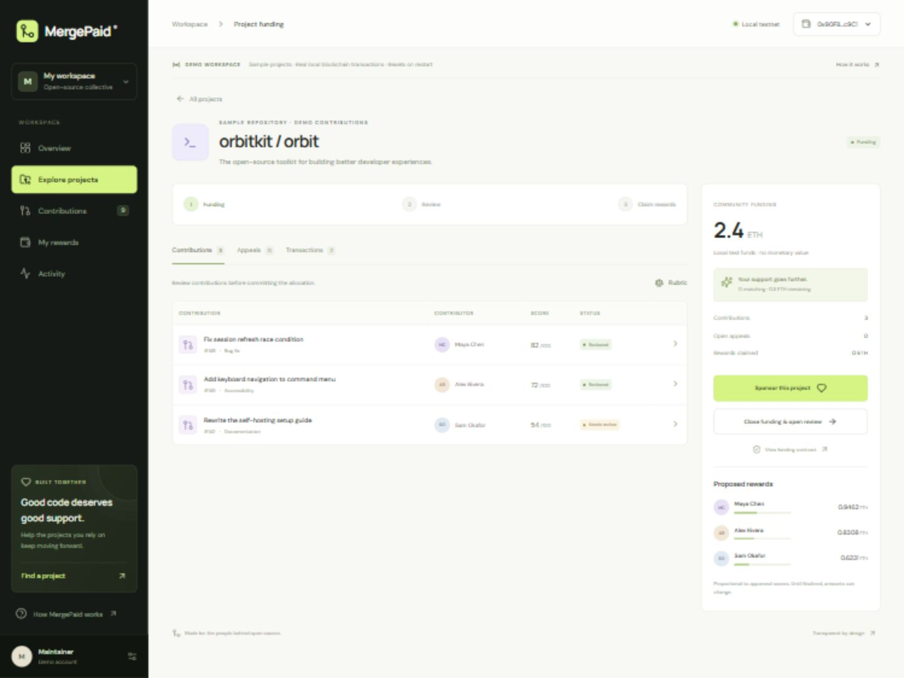
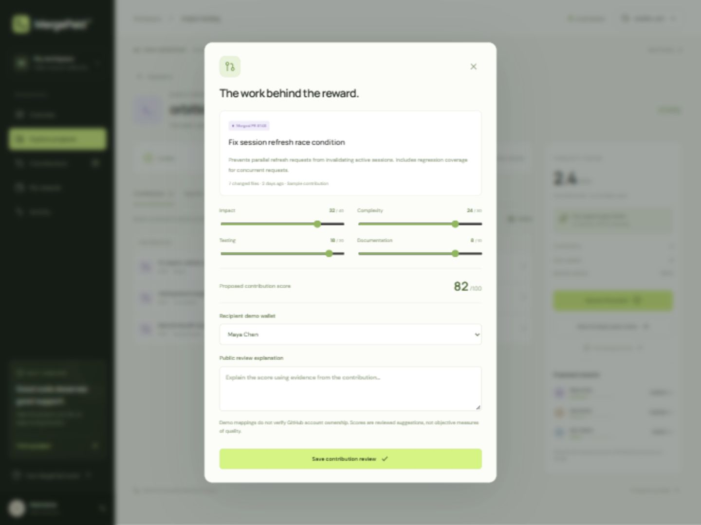
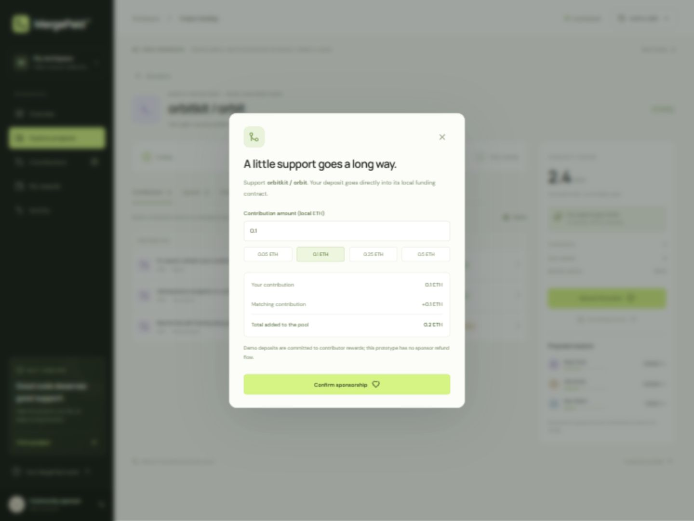
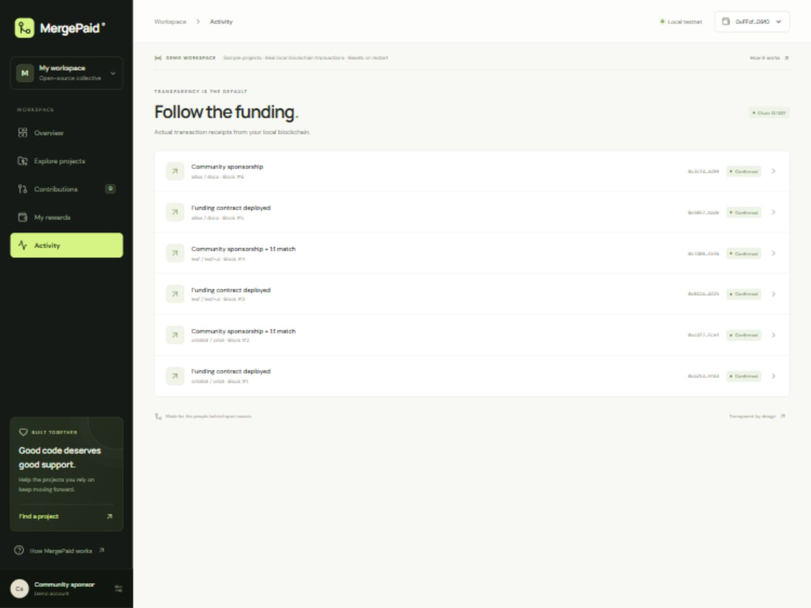
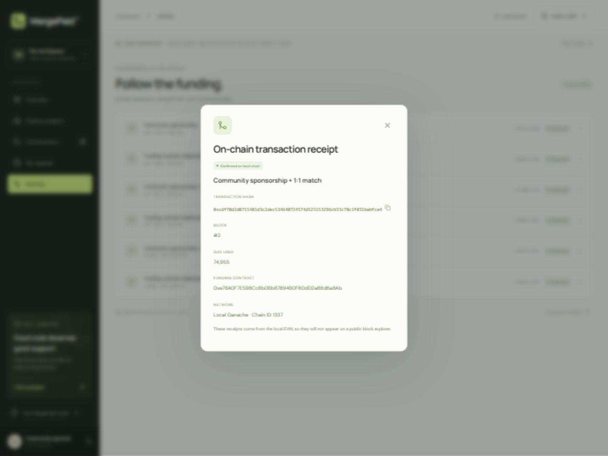
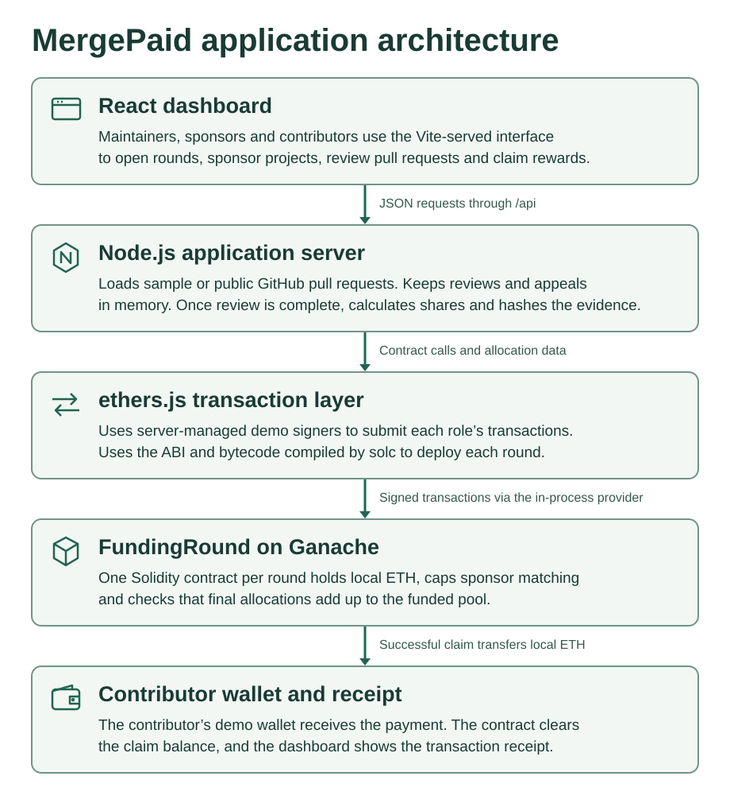

# MergePaid

### Fund the work. Reward the people.

An open-source funding platform that turns community sponsorship into **explainable contribution rewards and verifiable on-chain payouts**.

Maintainers open funding rounds, sponsors contribute with capped matching, and contributors earn rewards after a transparent review and appeal process.


> **Status:** Working local classroom prototype. Smart-contract transactions execute on a local blockchain using test funds. GitHub login, personal-wallet signing, AI scoring, and public testnet deployment are not implemented.

Inspired by [GitPaid](https://github.com/Kush134/Adventum_GitPaid). MergePaid is a new implementation, not a copy of its source.

[Screenshots](#screenshots) · [Getting started](#run-locally) · [Demo walkthrough](#presentation-walkthrough) · [Features](#implemented) · [Architecture](#architecture) · [Limitations](#prototype-boundaries) · [Roadmap](#next-production-milestones)

## Why MergePaid?

Open-source projects need sustainable funding, but donation totals alone do not explain who receives rewards or why. Commit counts also miss valuable documentation, accessibility, and maintenance work.

MergePaid makes the process visible: sponsors fund a repository, reviewers explain contribution scores, contributors can appeal, and approved rewards settle through a smart contract. Scores remain reviewable judgments rather than objective measures of a developer's value.

## Features at a glance

| Feature | What it does |
| --- | --- |
| Repository funding pools | Dedicated contract for each funding round |
| Sponsor matching | Pre-funded 1:1 matching with a hard reserve cap |
| GitHub imports | Import real merged PRs from public repositories |
| Explainable contribution reviews | Published scoring rubric and written reviewer decisions |
| Contributor appeals | Request reconsideration before allocations are finalized |
| On-chain rewards | Exact allocation accounting and one-time claims |
| Transparent activity | Transaction hashes, block numbers, gas usage, and evidence hashes |
| Demo role switching | Present sponsor, maintainer, and contributor perspectives |

## Screenshots

Captured directly from the running MergePaid app using a full desktop viewport. These show the implemented local prototype with labelled sample repositories and test ETH; they are not design mockups or a public-network deployment.

### Workspace overview



<details>
<summary>Explore projects — open full desktop screenshot</summary>

Repository discovery with funding status, contribution counts, and matching availability.



</details>

<details>
<summary>Funding round — open full desktop screenshot</summary>

Contribution table, round lifecycle, funding balance, matching reserve, and reward previews.



</details>

<details>
<summary>Contribution review — open full desktop screenshot</summary>

Human-review scoring rubric, recipient selection, and public review explanation form.



</details>

<details>
<summary>Sponsor matching preview — open full desktop screenshot</summary>

An actual sponsor form previewing a 0.1 ETH contribution plus a 0.1 ETH match. This is the preview before confirmation.



</details>

<details>
<summary>On-chain activity — open full desktop screenshot</summary>

Confirmed local contract deployments and sponsorship transactions.



</details>

<details>
<summary>Transaction receipt — open full desktop screenshot</summary>

A local sponsorship receipt showing its transaction hash, block number, gas usage, and contract address.



</details>

[Browse all original desktop screenshots](docs/screenshots/README.md)


## Run locally

Install Node.js 22.12+ (recommended) or 20.19+. Local verification used Node 24.7.0. No MetaMask, database, separate blockchain node, or API keys are required for the sample demo.

```bash
git clone https://github.com/surf3rr/MergePaid.git
cd MergePaid
npm ci
npm run dev
```

On Windows, if PowerShell blocks `npm.ps1`, use:

```powershell
npm.cmd ci
npm.cmd run dev
```

Open **http://127.0.0.1:5187**. Keep the terminal running. On Windows, `start.cmd` launches the app after dependencies are installed.

```powershell
npm.cmd test
npm.cmd run build
npm.cmd start
```

`npm start` serves the production build at http://127.0.0.1:3017. Both modes run Ganache in process; no separate chain or MetaMask setup is needed.

Run `npm run build` before `npm start`. Run development or production mode one at a time; both use API port 3017. Stop the running process with Ctrl+C before starting another.

| Command | Purpose |
| --- | --- |
| `npm run dev` | Start frontend, API, and local blockchain |
| `npm test` | Run contract and API integration tests |
| `npm run build` | Build the production frontend |
| `npm start` | Serve the production build with API and blockchain |

## Presentation walkthrough

1. Open **Explore projects → orbitkit / orbit**. This is an explicitly labelled sample repository; its three contribution records are fixtures.
2. Use the wallet menu in the top-right to switch to **Community sponsor**.
3. Sponsor 0.1 local ETH. Check the 1:1 match and the actual transaction receipt under Transactions.
4. Switch to **Maintainer**. Close funding and open review.
5. Switch to **Sam Okafor**. Open the documentation contribution and submit an appeal explaining its impact.
6. Switch to **Maintainer**. Review the documentation contribution, adjust its impact or complexity, and save a public reason.
7. Open Appeals, resolve the appeal with a reason, then finalize the allocation.
8. Switch to **Sam Okafor**. Open **My rewards** and claim. Inspect Activity for the transaction hash, block, and gas used.
9. The claimed button is disabled. Automated tests additionally attempt a second claim at contract and API level and verify rejection.

To use live public data, create a round with `owner/repository`, then import merged PRs. GitHub rate limits apply. The importer looks at the latest 30 closed PRs and imports at most six merged PRs; it is not a full repository history or a date-bounded funding-period import. It inspects up to 100 changed files per PR and detects test/documentation filenames. Passing CI and code quality are not inferred. Assign each author to one of the demo recipient wallets and review each score.

## Implemented

- Responsive React dashboard, search, project details, role switching, reward previews, receipts, and review logs.
- Public GitHub REST import, with timeouts, errors, and no token required.
- Published 100-point rubric: impact 40, complexity 30, testing 20, documentation 10.
- Off-chain review proposals and appeals. Open appeals and unreviewed contributions block API finalization.
- A Solidity contract per round. Native ETH deposits, pre-funded capped 1:1 matching, reviewer-only finalization, exact allocation conservation, checks-effects-interactions, and one-time claims.
- Allocation evidence, including reviews and appeals, hashed and committed in a finalization event. View the evidence from the funding contract dialog; `canonical` is the exact string whose UTF-8 keccak256 matches the recorded hash.
- Contract and API integration tests covering funds, permissions, appeals, immutable finalization, duplicate recipients, and duplicate claims.

## Prototype boundaries

**This is a local classroom prototype, not a public financial service.**

- All wallets are deterministic server-managed Ganache accounts. The role selector is a demo control, not authentication. Do not expose the API to a network or send real funds to any address.
- The API and development frontend bind to loopback. No private keys, GitHub secrets, or OpenAI keys are required.
- Chain and application state are in memory and reset when the server restarts. No database persistence is implemented.
- Sample repositories, people, PRs, and suggested scores are fixtures. On-chain transactions and contract balances are real within the local EVM; tokens have no monetary value.
- GitHub OAuth, wallet identity binding, personal-wallet signing, AI evaluation, public testnet deployment, and production authentication are not implemented.
- GitHub import proposals use neutral impact/complexity defaults and filename signals. They are not an objective assessment. Reviewers must inspect evidence; documentation work can also receive impact and complexity points.
- Appeals and review gates are enforced by the application API. The contract trusts the reviewer to choose the final allocation; it does not enforce a challenge period or prove GitHub facts.
- Sponsorships are irrevocable in this prototype. There is no expiry/cancellation refund path. The contract includes reviewer withdrawal of unused matching reserve after funding closes; no UI is provided for it.
- No separate platform fee. Rounding remainder goes to the final eligible recipient so the sum equals the pool exactly.
- Font styling optionally loads DM Sans and Manrope from Google Fonts. System fallbacks work offline; the sample demo itself needs no external service once dependencies are installed.
- Core components use accessible labels, keyboard focus styles, dialog focus trapping, and reduced-motion support. Browser QA results are recorded in VALIDATION.md.

## Architecture

| Layer | Technology |
| --- | --- |
| Frontend | React 18, Vite 6, Lucide icons, responsive CSS |
| API | Node.js built-in HTTP server |
| Public contribution data | GitHub REST API |
| Blockchain | In-process Ganache, chain ID 1337 |
| Contract interaction | ethers v6 |
| Smart contracts | Solidity 0.8.28, solc, Shanghai EVM target |
| Tests | Node.js test runner with real local EVM transactions |
| Storage | In-memory only |

### Application workflow



**Figure 1. MergePaid application architecture.** The dashboard sends user actions to the Node.js server, which manages contribution reviews and prepares reward allocations. Through ethers.js, the server submits transactions to each round’s Solidity contract on the local Ganache chain. A successful claim transfers local ETH to the contributor’s demo wallet.

[Report image (PNG)](docs/architecture.png) · [Vector image (SVG)](docs/architecture.svg) · [Editable Mermaid flowchart](docs/architecture.mmd)

The API serializes writes so two review/finalization operations cannot race. Native token amounts use integer wei; frontend decimal amounts are display-only. The contract is compiled on startup using Solidity 0.8.28 with the Shanghai EVM target. Ganache emits an optional native-module fallback warning on some Node versions; its JavaScript fallback is supported.

### Project structure

```text
MergePaid/
├── contracts/FundingRound.sol  # Deposits, matching, allocations, claims
├── docs/
│   ├── architecture.svg        # Technology-symbol architecture diagram
│   ├── architecture.png        # Presentation-ready rendered diagram
│   ├── architecture.mmd        # Editable Mermaid architecture
│   └── screenshots/           # Verified full-desktop app captures
├── public/favicon.svg
├── server/
│   ├── chain.mjs               # Solidity compilation and local EVM
│   ├── dev.mjs                 # Development launcher
│   └── index.mjs               # API, demo data, reviews, and GitHub import
├── src/
│   ├── main.jsx                # React workspace and interactions
│   └── styles.css              # Responsive styling
├── test/funding.test.mjs       # Contract and API integration tests
├── index.html
├── package.json
├── package-lock.json
├── start.cmd                   # Windows launcher
├── vite.config.js
├── VALIDATION.md
└── LICENSE
```

### Scoring and settlement

The rubric gives up to 40 points for impact, 30 for complexity, 20 for testing, and 10 for documentation. Documentation contributions can also earn impact and complexity points. Raw commit counts and lines changed do not directly earn rewards.

```text
Contributor reward = Funded pool × Contributor approved score / Total approved score
```

Scores are summed across each contributor's approved PRs. Calculations use integer wei, and any rounding remainder goes to the final eligible recipient. The contract requires allocations to equal the funded pool exactly.

The lifecycle is `Funding → Review → Finalized → Claims`. Appeals and review checks live in the application; the contract trusts its reviewer to finalize an allocation. Evidence hashes make the committed data verifiable, but do not prove GitHub facts or scoring fairness.

## Testing

```bash
npm test
npm run build
```

Integration tests cover capped matching, fund conservation, reviewer permissions, invalid allocation totals, duplicate recipients, successful transfers, duplicate-claim rejection, appeal ownership, unresolved appeals blocking finalization, immutable finalized scores, evidence hashes, and unrelated-origin API-write rejection.

See [VALIDATION.md](VALIDATION.md) for the verified browser walkthrough, responsive layout checks, and live public GitHub import check.

## Troubleshooting

- **PowerShell blocks npm:** use `npm.cmd` instead.
- **Port already in use:** stop the existing MergePaid process before starting a second. Frontend uses 5187; API uses 3017.
- **Ganache optional native-module warning:** its JavaScript fallback is supported and was used successfully during verification.
- **GitHub import fails:** check the public repository name, connectivity, and unauthenticated API rate limit. Sample rounds do not need GitHub access.
- **Data disappeared after restart:** chain and application state are in memory and reset on restart.
- **Fonts differ offline:** Google Fonts are optional; system-font fallbacks remain usable.

## Next production milestones

1. GitHub OAuth and signed wallet ownership verification, bound to stable GitHub user IDs.
2. Persistent database and chain state, authenticated roles, audit log, and rate limiting.
3. Period-bound contribution selection and contributor agreement before funding.
4. Signed evaluation attestations or an oracle integration, with explicit failure handling.
5. Contract-enforced review windows, cancellation/expiry rules, and refunds.
6. Optional AI proposals with structured evidence, human review, model/version tracking, and prompt-injection defenses.
7. External security review before considering funds with real value.

## License

MIT. See LICENSE.

## Contributing

Issues and pull requests are welcome. Keep changes focused, describe the behavior being changed, and run `npm test` and `npm run build` before submitting. Never commit secrets, wallet keys, local logs, dependencies, or generated build output.
