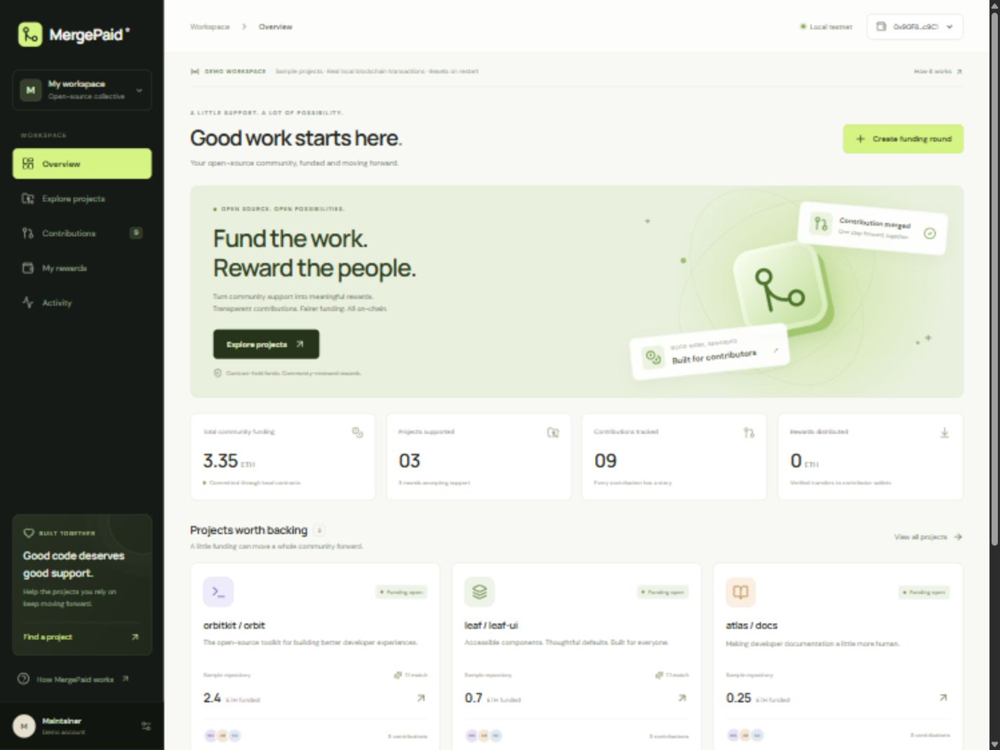
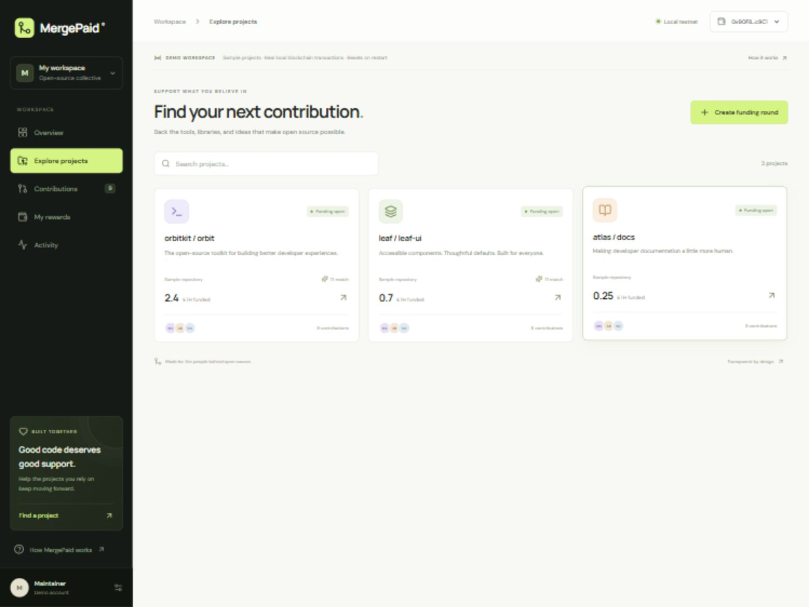
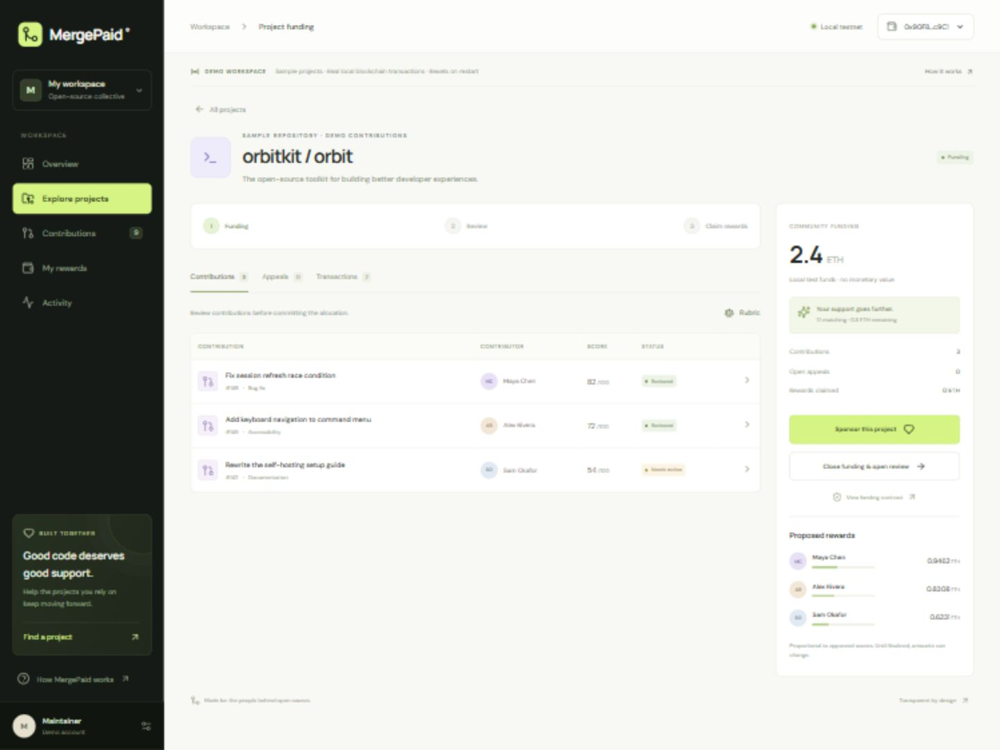
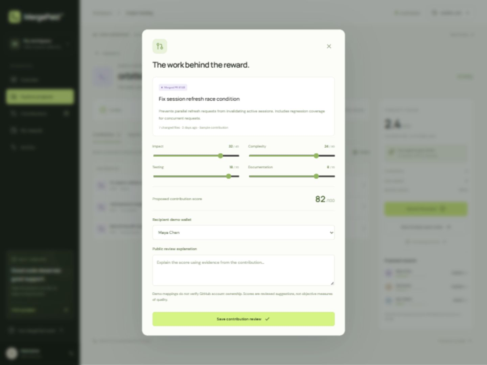
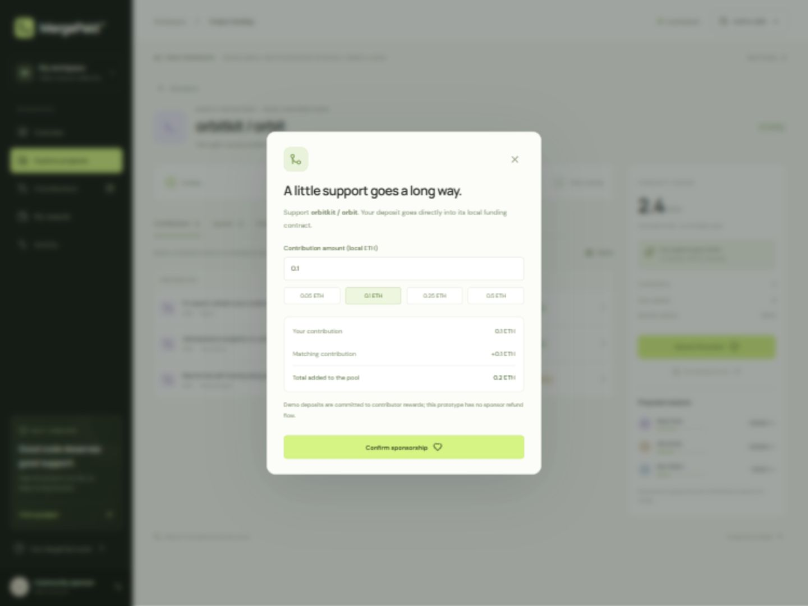
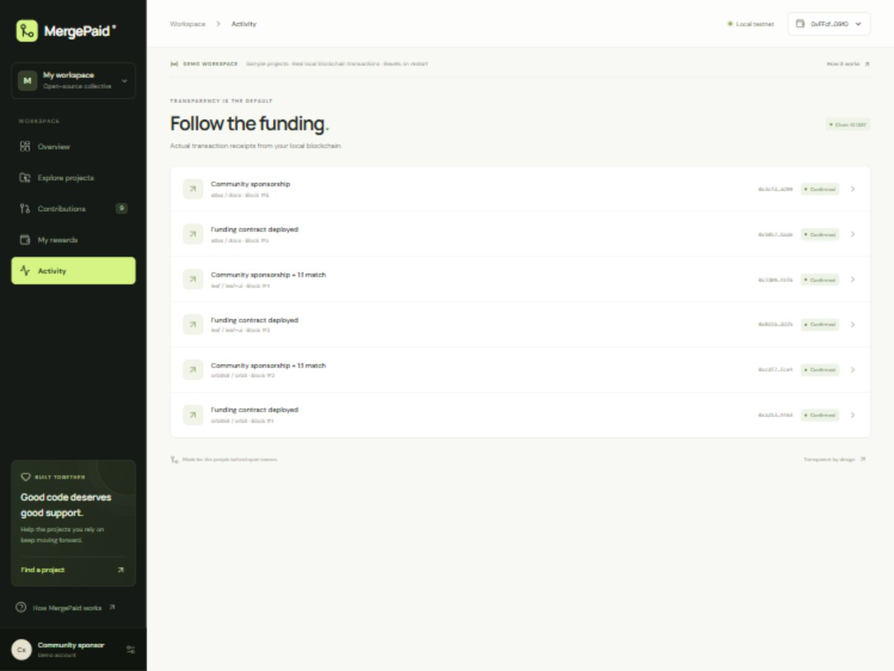
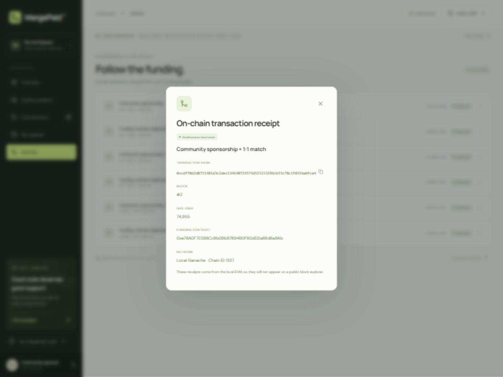

# MergePaid desktop screenshots

Captured from the running local app on 18 November 2026. Each image is an original desktop viewport capture, at least 1400 × 1000 pixels. Sample data and local test funds are labelled in the app.

No application records or transaction results were edited for these images. The sponsorship image shows a preview; the receipt image shows an already-confirmed local transaction.

## Workspace overview

Dashboard with community funding totals, project cards, and navigation.

## Explore projects

Repository discovery with funding status, contribution counts, and matching availability.

## Funding round

Contribution table, round lifecycle, funding balance, matching reserve, and reward previews.

## Contribution review

Human-review scoring rubric, recipient selection, and public review explanation form.

## Sponsor matching preview

An actual sponsor form previewing a 0.1 ETH contribution plus a 0.1 ETH match. This is the preview before confirmation.

## On-chain activity

Confirmed local contract deployments and sponsorship transactions.

## Transaction receipt

A local sponsorship receipt showing its transaction hash, block number, gas usage, and contract address.

